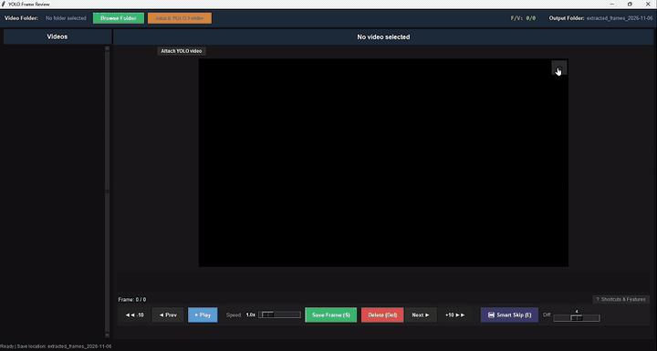

# YOLO Frame Review

Pick training frames from **hours-long videos**, side by side with your YOLO model's output.



You run a detector over long footage, render the predictions into a video, and now need to find the
frames where it got things wrong so you can label them and retrain. Generic video players lag on long
files and can't save the clean frame behind an annotated one. This tool does exactly that one job, fast.

> **Personal project.**

## Features

- **Smooth on hours-long video** — short hops decode forward instead of re-seeking, slider-drag previews
  decode on a background thread, zoom never re-decodes. See [Performance](#performance).
- **YOLO twin view** — attach the YOLO-rendered version of a video and browse it frame-for-frame.
  Saving always writes the **original, unannotated** frame.
- **Attach a whole YOLO folder** — every video is paired automatically by filename (see below).
- **Smart Skip** — jump to the next frame that is visibly different, skipping near-duplicates.
- **Session tracking** — saved frames are marked on the timeline and per video; resume where you left off.
- **Per-video notes**, zoom/pan, playback at 0.1x–8x.

## Install

Python 3.9+ with Tkinter (bundled with the standard Windows/macOS installers; on Linux `apt install python3-tk`).

```bash
git clone https://github.com/virkha-kumari/YOLO-Frame-Review-Extract.git
cd YOLO-Frame-Review-Extract
pip install -r requirements.txt
python -m yolo_frame_review
```

`python -m` takes a module name, not a path, so run it from the repo root.

**Run from any folder:** install it once in editable mode. This registers a `yolo-frame-review` command
(defined in `pyproject.toml`, calls `app:main`) in your active environment:

```bash
pip install -e /path/to/YOLO-Frame-Review-Extract
yolo-frame-review
```

Editable mode points at your clone, so code changes apply without reinstalling.

## Usage

1. **Browse Folder** — pick the folder with your source videos (subfolders included), then choose where
   frames get saved.
2. Navigate with the keyboard; press **S** to save the current frame (auto-advances).
   Click **? Shortcuts & Features** (below the video) for the full list of keys and features.
3. Optional: **Attach YOLO Folder** (top bar, next to Browse Folder) pairs every video at once, or
   **Attach YOLO video** (above the player) attaches one.

Frames are saved as `<output>/<video_name>/<video_name>_frame_000123.jpg`.

### YOLO folder pairing

For each source video, the name is reduced to a key by dropping a trailing `_raw`:

| Source video | Key | Matches | Doesn't match |
|---|---|---|---|
| `cam1_0800_raw.mp4` | `cam1_0800` | `cam1_0800.mp4`, `cam1_0800_yolo.mp4`, `cam1_0800_raw_pred.mp4` | `cam1_08001.mp4` |

The YOLO file name must **start with the key** followed by a non-alphanumeric character (or end), case-insensitive.
A candidate is accepted only if it has the **same frame count and FPS** as the source — the viewer maps
frame *n* to frame *n*. Any video with no match, a length mismatch, or more than one valid match is listed
in one summary dialog (full list also printed to the console).

### Shortcuts

| Action | Keys |
|---|---|
| Previous / next frame | `A` / `D`, `←` / `→`, `4` / `6` |
| Jump −10 / +10 / +20 / +30 / +50 | `Z` / `1` / `2` / `3` / `5` |
| Jump ±100 | `Shift+A` / `Shift+D` |
| Previous / next video | `W` / `Shift+S`, `↑` / `↓` |
| Play / pause | `P` |
| Save frame | `S`, `0`, `+`, `=`, `Q` |
| Remove saved mark | `Delete` |
| Smart Skip | `E` |
| Zoom / recenter / reset | scroll wheel / click / double-click |

## Performance

Target: hours-long videos (millions of frames) must step, scrub, zoom and play without lag on a laptop.

**1. Grab forward instead of seeking.** `cap.set(CAP_PROP_POS_FRAMES, n)` always jumps to the nearest
keyframe *before* `n` and decodes forward, even for `n = current + 1`. With long GOPs that is dozens of
decodes per step. For forward hops of up to 40 frames the code calls `cap.grab()` sequentially instead,
which keeps decoder state and only decodes the frames in between. Real seeks happen only for backward
or long jumps.

**2. Slider scrubbing on a background thread.** Dragging moves the handle and frame label instantly on
the UI thread; decoding goes to a worker thread with its **own** `VideoCapture` (no races with the main
one). The request slot holds only the **latest** position, so while you drag older requests are
overwritten, not queued, and the preview never falls behind the mouse. On release, the exact frame is
decoded once on the main capture.

**3. Stale frames are dropped.** Every video switch or YOLO attach/detach bumps a generation counter.
A preview that finishes decoding after the switch carries the old generation and is discarded.

**4. Never decode the same frame twice.** Save reuses the frame already decoded for display. Zoom and
pan re-render from the frame on screen without touching the decoder. The canvas image item is reused
instead of recreated each frame, and the preview resize uses `INTER_NEAREST` (saved frames stay full
resolution).

**5. Playback that respects Tk's timer.** `after()` on Windows has roughly 16 ms resolution. At high
speeds the ideal delay is below that, so playback advances several frames per tick instead.

**6. Smart Skip reads sequentially.** One seek, then forward reads, comparing a 160×90 grayscale
thumbnail every 5th frame against the start frame.

## Data & privacy

Session state is written to `extraction_session.json` in the working directory (saved frame indices,
video paths, notes). It and the `extracted_frames_*` folders are in `.gitignore` — keep it that way.

## Development

```bash
python -m unittest discover tests
```

```
yolo_frame_review/
  app.py           Tkinter GUI
  video.py         seeking, metadata probing, background scrub worker
  yolo_pairing.py  filename matching + frame/fps validation (pure, tested)
  session.py       session JSON load/save
```
